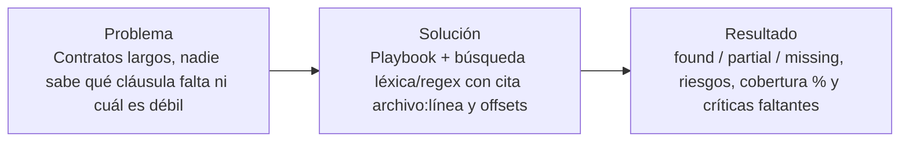

<div align="center">

# contract-clause-finder

**Buscador local de cláusulas contractuales** · Angel Salazar

`contrato + playbook → cita con offsets o cláusula faltante/riesgosa → cobertura`

</div>

---

### `$ cat diagrama.md`



---

### `$ cat problema.md`

Un MSA de SaaS llega con 30 páginas y el equipo legal necesita saber en minutos si hay tope de responsabilidad, derechos de terminación, aviso de incidentes y confidencialidad.  
Cada cláusula del playbook se busca en el contrato: se cita el pasaje exacto con sus offsets, se marca como incompleta o ausente, y se señala el lenguaje débil ("best efforts", "sole discretion", responsabilidad ilimitada). Todo local, sin LLM ni nube.

---

### `$ ./check.sh`

```bash
python -m venv .venv
.venv\Scripts\activate
pip install -e .
pytest
contract-clauses scan --playbook samples/playbook/saas_clauses.json --contract samples/contracts/good_msa.txt
contract-clauses scan --contract samples/contracts/weak_msa.txt --fail-under 80
contract-clauses compare
contract-clauses history
contract-clauses serve
```

También funciona como `python -m contract_clauses <comando>`.

UI: http://127.0.0.1:8031

Salida en `results/`: `clause_report.md`, `clause_report.json`, `compare_report.md`, `compare_report.json` y `history.db` (SQLite).

| Comando | Qué hace |
|---|---|
| `scan --playbook P --contract C` | Evalúa uno o varios contratos (`--contract` repetible, acepta carpetas). `--fail-under N` devuelve código 2 si la cobertura es menor. |
| `compare [--good A --weak B]` | Contrasta dos contratos cláusula por cláusula. |
| `history [--limit N]` | Lista las corridas guardadas en SQLite. |
| `serve [--port 8031]` | UI con la matriz cláusula × estado y las citas. |

---

### `$ cat playbook.md`

```json
{
  "id": "LIAB-01",
  "title": "Limitation of liability",
  "critical": true,
  "weight": 3,
  "must_have": [
    "aggregate liability|total liability|liability shall not exceed",
    "re:fees\\s+(?:paid|payable)|(?:twelve|12)\\s*(?:\\(12\\)\\s*)?months",
    "indirect|consequential|special|incidental"
  ],
  "keywords": ["gross negligence|willful misconduct|fraud", "each party|mutual*"],
  "risk_flags": [
    { "id": "unlimited-liability", "pattern": "unlimited\\s+liabilit\\w+", "note": "Responsabilidad ilimitada", "severity": "high" }
  ],
  "if_missing": "Sin tope de responsabilidad: exposición económica efectivamente ilimitada",
  "suggestion": "Each party's total aggregate liability is limited to the fees paid or payable in the twelve (12) months before the claim."
}
```

- `must_have`: grupos de frases obligatorias; `|` separa alternativas equivalentes, `terminat*` cubre variantes, y un grupo que empieza con `re:` es una regex completa. El primer grupo es el ancla del tema.
- `keywords`: términos de apoyo que no bastan por sí solos.
- `risk_flags`: regex de lenguaje débil propio de la cláusula, con severidad `low|medium|high`.
- `if_missing` y `suggestion`: nota de brecha y texto sugerido cuando la cláusula falta o está incompleta.

El playbook incluido (`saas_clauses.json`) trae 21 cláusulas, 7 críticas: protección de datos, aviso de incidentes, seguridad, confidencialidad, indemnidad, límite de responsabilidad y terminación.

---

### `$ cat reglas.md`

- Contrato dividido en unidades (párrafos y cláusulas numeradas) y secciones por encabezado. La mejor ventana de hasta 8 unidades, sin cruzar secciones, es la cita.
- `found`: todos los grupos `must_have` aparecen en la ventana. `partial`: aparece el ancla, o al menos dos grupos, o dos keywords sin frases. `missing`: nada utilizable.
- Puntaje por cláusula: `found` 0.85–1.00 según keywords; `partial` 0.25–0.75 según grupos cubiertos; `missing` 0.
- Cobertura global ponderada por `weight`. La cobertura ajustada multiplica por 0.95 / 0.85 / 0.60 según el riesgo de texto más alto (low / medium / high).
- Veredicto: `strong` desde 85% sin críticas incompletas, `acceptable` desde 65% sin críticas ausentes, `weak` en otro caso.
- Riesgo genérico en toda cláusula: `best efforts`, `sole discretion`, `as is`, `no obligation`, `without notice`, términos pendientes, responsabilidad ilimitada, modificación unilateral y `Provider may`.
- Una negación junto al ancla ("Customer has no right to terminate") no cuenta como evidencia y se muestra como contra-evidencia.
- Offsets en caracteres sobre el texto leído tal cual; cada cita indica `archivo:Lnúmero [inicio–fin]`.

---

### `$ cat estructura.md`

```
contract-clause-finder/
  samples/playbook/saas_clauses.json
  samples/contracts/good_msa.txt        # 98.5% de cobertura
  samples/contracts/weak_msa.txt        # faltan responsabilidad, terminación, incidentes, confidencialidad
  src/contract_clauses/
    playbook.py  corpus.py  finder.py  risk.py  scorer.py
    report.py    store.py   cli.py     web.py   templates/index.html
  tests/test_finder.py
```

---

Hecho en Lima · Angel Salazar · CIP 404730
